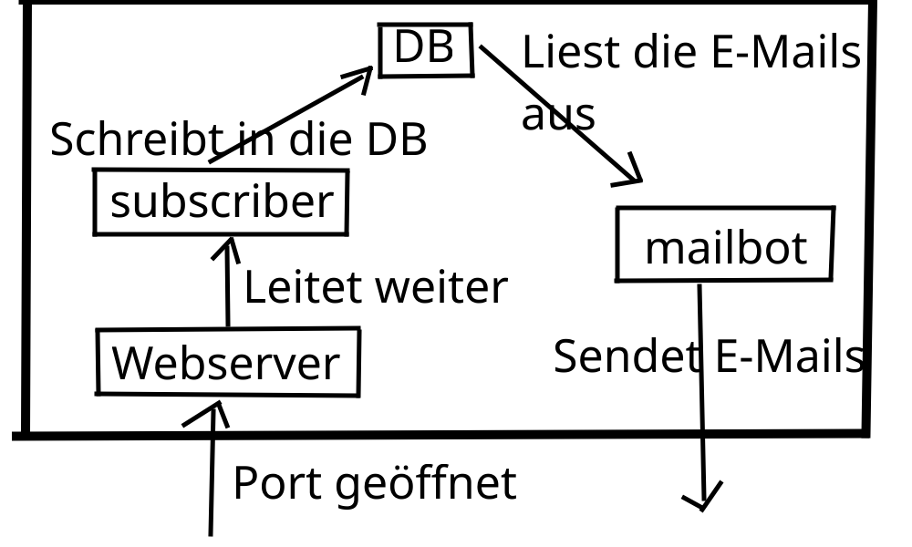

# Newsletter Demo
**Warning: This s just a demo for now**
## Container Planning

### used Software
| Function | Software |
|-------|-----|
| Webserver| NGINX? |
| DB | PostgreSQL |
| DB library for Rust | [SQLx](https://crates.io/crates/sqlx) |
| Mail library | [lettre](https://crates.io/crates/lettre)? |
### E-Mail verification:
1. E-Mail format input validation(lib.rss)
2. [Check if it exists](https://crates.io/crates/check-if-email-exists)
3. Verification link
After all these steps were successfull, the address is written to the DB
## Project structure
- docker/  # All Container related files
  - subscriber/  # Conatains *subscriber* Container
    - Dockerfile # Build the Container for *subscriber*
  - mailbot/     # Conatains *mailbot* Container
    - Dockerfile # Build the Container for *mailbot*
- src
  - src/
    - subscriber.rs  # Takes Input and puts it in a DB  
    - mailbot.rs     # Automatically sends E-Mails to subscribed Inboxes
  - lib.rs       # Shared functionality between subscriber and mailbot(Input Validatio lays here)
- Cargo.toml # Rust project config
- Cargo.lock # Dependecy lockfile
- compose.yaml # configures all needed Containers
- .secrets/  # not commited. Contains secrets for the Containers(e.g. DB Password)
- .gitignore

## Deploy
### Prerequisites
- create DB secrets:
  - `.secrets/pg-subscriber` # Postgres-password for *subscriber*
- Ensure correct SELinux label: container_file_t

run `docker compose up`

## Project TODO:
- [x] Input verification
- [ ] Database setup
- [ ] mailbot
- [ ] Webserver setup
- [ ] Extenting tests (for lib crate)
- [ ] Extending Project Docs/Comments
